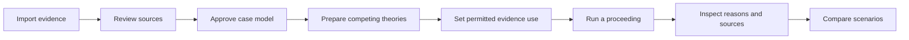

<p align="center">
  
</p>

# TrialLens

### See the evidence. Test the argument.

**A local AI workspace for exploring evidence, rehearsing courtroom arguments, and inspecting how a simulated decision was reached.**

A receipt shows that money changed hands. An email leaves the reason disputed. Two advocates read the same record differently. TrialLens gives you a place to examine those competing accounts, test them in a structured proceeding, and follow the resulting reasons back to the supplied evidence.

Bring the documents. Build a case model. Keep each side's theory separate. Rehearse the proceeding. Then inspect what supported the decision—and what remains unresolved.

**[Get started](#run-locally)** · **[Try a fictional case](#your-first-case)** · **[Explore the workflow](#from-evidence-to-reasons)** · **[Detailed guide](docs/user-guide.md)** · **[Rebrand plan](docs/plans/2026-10-06-triallens-rebrand.md)**

> **Research and rehearsal software.** Generated arguments and decisions can be wrong. Synthetic panels are not representative juries, and their votes are not real-world verdict probabilities. TrialLens does not provide legal advice or binding court outcomes.

## What can you explore?

| Your question | What TrialLens lets you do |
| --- | --- |
| What does this document actually establish? | Open extracted passages alongside preserved originals, source hashes, and extraction warnings. |
| Where do the two accounts diverge? | Prepare separate side theories and map supporting, contrary, or disputed passages to individual elements. |
| What should each participant be allowed to see? | Define document-use restrictions, role visibility, permitted purposes, and scoped passages. |
| How does an argument withstand opposition? | Rehearse openings, responses, motions, witness examination, and deliberation through the available workflows. |
| Why did this simulated panel decide that way? | Inspect recorded ballots, explanations, events, and saved evidence-to-decision traces. |
| What changes when the assumptions change? | Compare saved runs in the Robustness Lab, including different document-use versions and seeds. |

## From evidence to reasons



### 01 · Build a record you can inspect

Create a matter from a case narrative, upload individual exhibits, or preview and import a folder or ZIP. Original files are preserved with SHA-256 hashes. Extracted passages, stable exhibit identifiers, and review warnings help you check what the model actually received. Sparse PDF text triggers an attempt at local OCR; significant wording still needs checking against the original.

### 02 · Separate evidence from advocacy

Define the parties, issues, elements, burdens, and permitted outcomes in a neutral case model. Map passages to supporting, contrary, and disputed propositions. Prepare each side's private theory separately from the evidentiary record, then approve a version before starting a new proceeding.

### 03 · Rehearse a structured proceeding

The Full Proceeding workspace has adapters for Ontario criminal jury, Ontario civil, and Capital Markets Tribunal simulations. It combines procedural stages, motions, document-use settings, model-generated participants, and recorded decisions. Criminal-jury runs collect independent per-count ballots; civil and tribunal paths use their own configured decision structures.

The optional **Courtroom protocol** adds examination checkpoints, objections, jury absence and return, judicial effects, and participant-memory inspection. It remains opt-in while release review is open. Focused bail and resolution-conference rehearsals are also available in the existing **TrialForge** workspace.

### 04 · Follow the reasons back to the record

Inspect the decision sheet, element mappings, ballot explanations, and saved source passages. Factual-source checks can flag, repair, or withhold unsupported generated output and preserve the audit history. These checks are fallible; they do not authenticate documents or certify legal conclusions.

### 05 · Ask a better next question

Use the Robustness Lab to compare a baseline with further runs. See changes in source-use settings, seeds, recorded outcomes, and ballot choices. The comparison helps you explore sensitivity to the inputs; it does not establish causation or predict an actual court.

## Your first case

Start with the included **[fictional Crown and defence packet](samples/criminal-fraud/README.md)**. Its receipt, transfer, and ambiguous email support competing inferences, making it useful for learning how the workflow handles disputed authorization.

1. Paste [scenario.txt](samples/criminal-fraud/scenario.txt) into Case Intake and save the matter.
2. In Full Proceeding, preview and import only the packet's [sources](samples/criminal-fraud/sources) folder.
3. Select Ontario criminal jury, review the neutral case model, and approve it.
4. Add the [Crown](samples/criminal-fraud/crown-argument.md) and [defence](samples/criminal-fraud/defence-argument.md) arguments as private Side Theories. Keep them out of the exhibits.
5. Review source-use settings and workflow checkpoints before running with your configured provider. Afterward, inspect the decision and its source trace.

To exercise the fictional workflow with scripted actors and an isolated temporary database:

```sh
npm run test:arguments
```

This test makes no external provider calls. Its predetermined outcomes verify software behavior; they are not an evaluation of live model reasoning.

## Run locally

**Requirements:** Node.js `>=24.15.0 <25`, npm `>=11.12.1 <12`, and a separately running OpenAI-compatible model server for local model-generated proceedings. The example configuration uses Ollama; installing this app does not install or download a model.

From your checkout, in PowerShell:

```powershell
npm ci
Copy-Item .env.example .env.local
npm run dev
```

Copy the environment template on first setup only; preserve an existing `.env.local`.

Open **[127.0.0.1:5173](http://127.0.0.1:5173)**. The API runs on port `5174` by default.

The supplied local-provider settings in `.env.local` are:

```dotenv
MODEL_PROVIDER=openai-compatible
OPENAI_COMPATIBLE_BASE_URL=http://localhost:11434/v1
OPENAI_COMPATIBLE_API_KEY=ollama
OPENAI_COMPATIBLE_MODEL=qwen2.5:14b
```

Set the model name to a model actually available on your server. These example values are configuration defaults, not a claim that a particular model meets the project's quality requirements.

For external MiniMax calls, set `MODEL_PROVIDER=minimax` and supply `MINIMAX_API_KEY` in `.env.local`. External use sends model context to that provider; the Full Proceeding workflow requires external-disclosure confirmation. Provider timeouts, retries, token budgets, media-extraction prerequisites, and remote access are covered in the **[detailed guide](docs/user-guide.md)** and **[environment template](.env.example)**.

## Local storage, explicit provider choice

Matters, extracted evidence, proceedings, and audit records are stored locally in SQLite and file storage. Originals remain available for inspection. Saved proceedings can be reopened, and supported failed or interrupted runs can resume from their recorded state.

Local storage and model processing are separate choices: a local model endpoint keeps model processing on your configured local runtime; an external endpoint transmits the supplied context. Review the provider configuration before using sensitive material.

For backup and restoration, follow **[Recovery and archive compatibility](docs/recovery-and-archives.md)**. Preserve the database and its evidence stores together. Existing `JUDGE_JURY_*` settings, archive identifiers, and database paths remain valid during the rebrand.

## Under the hood

| Layer | Implementation |
| --- | --- |
| Workspace | React, TypeScript, Vite |
| API | Express and TypeScript |
| Persistence | Local SQLite, versioned migrations, preserved evidence files |
| Model runtime | OpenAI-compatible local endpoint or configured MiniMax provider |
| Evidence intake | Document extraction, folder/ZIP ingestion, local PDF OCR attempts |
| Proceedings | Versioned case models, procedural adapters, event history, actor context, ballots |
| Inspection | Source passages, factual-source audits, decision traces, scenario comparisons |
| Verification | Vitest, Playwright journeys, scripted fictional evaluations |

## Development and verification

```sh
npm run lint
npm run typecheck
npm test
npm run build
```

| Command | Purpose |
| --- | --- |
| `npm run test:ui` | Browser smoke journey and saved rehearsal checks |
| `npm run test:sim` | Legacy simulation against a scripted provider |
| `npm run test:arguments` | Fictional evidence-to-decision browser workflow |
| `npm run test:courtroom` | Courtroom protocol browser journey |
| `npm run eval:courtroom` | Scripted fictional courtroom evaluations |
| `npm run coverage:all` | Aggregate server and isolated browser coverage checks |
| `npm run check:authorities` | Reachability of curated authority links, not legal validation |

Passing scripted tests establishes behavior under those fixtures. Live semantic quality and legal correctness require separate review. See the [evaluation guide](docs/evals/courtroom-realism.md), [implementation evidence](docs/qa/courtroom-realism-tdd.md), and [release review worksheet](docs/qa/courtroom-release-review.md) for the relevant boundaries and remaining checks.

## The TrialLens identity

TrialLens is the new project name. The running app currently retains **Judge & Jury** and **TrialForge** labels; the [rebrand plan](docs/plans/2026-10-06-triallens-rebrand.md) covers the remaining interface, export, and repository changes.

The lens represents examining a claim closely. The connected papers represent a record whose relationships can be inspected. The navy, ivory, copper, and muted teal palette carries that idea across the [hero](docs/brand/triallens/hero.png) and [emblem](docs/brand/triallens/emblem.png).

*Artwork generated with OpenAI's built-in image generation tool. It is brand illustration, not an application screenshot. [Asset specifications and prompts](docs/brand/triallens/README.md).*

## License

The original code, documentation, and fictional samples are licensed under **[AGPL-3.0-only](LICENSE)**, with the exclusions described in the **[licensing policy](docs/licensing.md)**. Commercial use is permitted under the AGPL; separate commercial terms may be negotiated where the maintainer holds the necessary rights.

The generated hero and emblem are excluded from the software license. TrialLens branding does not grant trademark rights or imply endorsement of independently operated forks.
