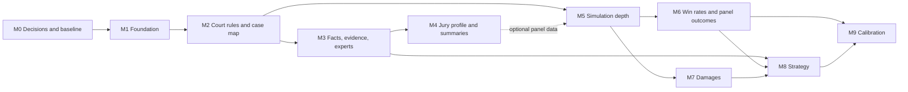

# Plan: case intelligence and jury research features

Date: November 8, 2026 (America/Toronto)

Status: M8 part B (F15, advocacy style studies) is built on `feature/case-intelligence-m1-artifacts`, not committed: a closed, code-written style catalogue (`server/styles/catalogue.ts`, version `advocacy-styles-1`: moral appeal, pragmatic dealmaking, expert-driven logic, theatrical storytelling, plain and factual, concise, thorough; each ends with a guardrail requiring the admitted evidence; a scan test fails on text about fabricating, coaching, concealing, protected characteristics or figures; **custom styles are not built**); a per-run `advocacy: [{ partyId, id }]` whose pinned text reaches only that party's opening and closing requests, refused for the courtroom protocol, criminal, tribunal, judge-alone and no-jury runs, a run with no court rules chosen, and an unknown party or style, with a non-public `advocacy_style_applied` event and runs with no style byte-identical (the golden regression is unchanged and green); a paired study on common seeds (the baseline and each style, one run at a time through the job queue under the hard cap, cost preview that equals the shared per-run estimate times runs times conditions, estimate hash, resume, a cost cap that **replaces the limit of 24 variants for this study**; the legacy robustness variants keep their limit of 24); statistics from `server/forecast/styleEffects.ts` (paired differences, seeded bootstrap intervals, length control by regression, exploratory below 20 seeds, "no reliable difference" and "insufficient data" as results, a multiple-comparison caution because the intervals are not adjusted); a `style_study` artifact (owner audience, draft and approve, hash verified, out of date when the approved case model, court rules, jury profile or style catalogue changes), Markdown and HTML export with the D1 sentence, routes in `server/routes/styleStudies.ts` and a Style studies tab in the Strategy area; no migration and no new archive format (the fail-closed check for the run setting was added to import). Not built: phase-by-phase blends, comparisons by element, damages and juror group, styles for witness examinations, and custom styles. It was built and tested with a scripted model and fictional data only: **live-model behaviour (whether a live model follows a style, whether a style moves a live simulated juror, whether a live argument stays within the admitted evidence) is NOT verified and nothing is calibrated.** M7 (F12 damages modelling and caps, F13 jury psychology on damages) is built on `feature/case-intelligence-m1-artifacts`, not committed: a `damagesCategories` court rule (unknown in the Ontario seed pack, as are caps, order, interest and collateral benefits, until a reviewer enters them); a per-run `damagesAmounts: true` (needs ballot contract v2) in which every juror gives amounts per category in both ballot rounds, the panel award being the median of the valid final juror amounts, with the before and after deliberation shift, no added model calls and the golden regression unchanged; a per-run `damagesCondition` that adds a fixed code-written submission to a closing argument (full runs only) and is refused with a readable reason when the rules forbid or do not state counsel suggesting amounts; user inputs saved as versioned hash-checked `damages_model` artifacts; a damages study (seeded runs through the job queue, zero-inflated fit, percentiles conditional on liability and unconditional, then the deterministic pipeline in the rules' stated order with a ledger, gross and net-collectible ranges, a cap check, and a stop that names any missing rule or input); a psychology study on common seeds (paired effects with intervals, "no reliable effect", backfire, numeracy-trait interaction only, human research as a reference); routes in `server/routes/damages.ts`, Markdown and HTML export, and Damages and Jury psychology tabs in the Strategy area; no migration and no new archive format. It was built and tested with a scripted model and fictional data only: **live-model damages behaviour is NOT verified and nothing is calibrated.** The verification layer is built on `feature/case-intelligence-m1-artifacts`, not committed: one serial, isolated browser journey (`npm run test:intelligence`, `e2e/case-intelligence.ts`) over the fictional civil fixture with scripted models, and a scripted evaluation (`npm run eval:intelligence`, `scripts/evaluate-case-intelligence.ts`) that scores the real services against the answer key from one threshold file, proves it can fail with a deliberately degraded client, and checks seven invariants; both are in CI after the other browser journeys. The `--live` path is implemented, gated like `eval:courtroom -- --live`, and has not been run, so the 90 percent precision and recall targets are proposed and unverified against any live model; the damages (M7) journey step is still an empty extension point, and the style-study (M8 part B) journey step is built. See [docs/evals/case-intelligence.md](../evals/case-intelligence.md). M8 part A (F14, case improvement strategies for any party, default the plaintiff) is built on `feature/case-intelligence-m1-artifacts`, not committed: a weakness register computed in code (coverage gaps, record gaps, timeline conflicts, expert vulnerabilities, disclosure findings, simulated juror ballots and appraisals from completed runs, the party's own approved summary weaknesses, and optional forecast and damages signals behind a registry that returns none when absent) with severity `round(100 × weight × lackOfSupport × dispute)` and every item citing its artifact, item and checked passages; model-proposed cures for the most severe weaknesses (approved authority or "needs research", effort, risk, success indicator); a separate speculative-ideas pass whose ideas must cite the record and survive an adversarial critique decided in code; labelled what-if scenarios kept inside the artifact (tested never to reach the evidence tables, ledgers, case model or juror and witness requests); deterministic fabrication, alteration, false-testimony, coaching and concealment refusals (instructions refused with a 422 before any call, model output refused and listed); `draftMotionDocket` takes any party (section 12 item 9 fixed); job kind `improvement_plan`, routes, export and a Case improvement plan tab in the Strategy area; no migration. **Live-model strategy quality is NOT verified**, the refusal patterns are a floor and not a guarantee, and nothing here is legal advice. M5 part B (F9, the jury deliberation forecast) is built on `feature/case-intelligence-m1-artifacts`, not committed: a per-run `deliberationForecast: true` with a pinned `strawPollCounts` (`visible` by default, or `hidden`), refused for judge-alone, tribunal and `courtroom_v1` runs; a straw poll after each challenge round, stored as trial events and never as ballot rounds, whose counts the jurors see only when the run says so and whose individual votes stay private either way; a reply target and stance recorded and checked on every deliberation turn; a seeded speaking order and an airtime share of a fixed number of turns, from the derived roles (`forepersonControlsVote` stays false); `server/deliberationAnalysis.ts`, pure code that reports camps, friction, holdouts, who moved whom, the vote path and a panel with no agreement without forcing one; a table across runs in exactly the shape `estimateSchemeTable` takes; `GET /api/trials/:runId/deliberation` and `GET /api/matters/:matterId/deliberation/table`; the Deliberation forecast screen beside the Juror journey; the run settings and a cost preview that matches a scripted run's calls. Runs that do not opt in are byte-identical (the golden regression test is unchanged and green); no migration and no new archive format were needed. It was built and tested with a scripted model and fictional data only: **live-model deliberation behaviour is not verified** (whether a live model names a real earlier contribution, chooses sensible stances, explains a change with a visible event, or passes the source check when it mentions the counts), and the role weights, airtime rule and friction score are uncalibrated assumptions. M6 (F10 win rates and F11 panel outcomes) is built on `feature/case-intelligence-m1-artifacts`, not committed: a forecast study runs seeded runs of the approved case model through the job queue one at a time under the hard cap and resumes after an interruption, then computes per-defendant per-claim win probabilities with Wilson intervals over runs, the exact panel math with an estimated juror correlation, the deliberation table, a rule-sensitivity table, vote-split distributions and the whole verdict form, all deterministically from the study seed and stored in a `forecast` artifact (schema unchanged; the manifest gained an optional `seed`), with routes, Markdown and HTML export and a Strategy area screen. Per D1 every screen, export and API answer says the probabilities come from simulated panels and have not been tested against real outcomes, and the product statements in the README, the run screen and the user guide were revised; of the two engine disclaimers in `server/trialEngine.ts`, the scenario-comparison text now carries the shared "not yet tested" sentence; the `run_created` text is deliberately unchanged: it is part of the event history that later prompts include, so editing it changes the prompts of every run that did not opt in (the engine golden fixture caught this when it was tried). Revising it is a separate, owner-approved change to the default engine, with a deliberate golden regeneration; the opt-in screens and exports already carry the not-yet-tested sentence. It was built and tested with a scripted model and fictional data only: **live-model results and calibration (M9) are not verified**. M5 part A (the upgraded ballot contract and F8, juror cognition) is built on `feature/case-intelligence-m1-artifacts`, not committed: a per-run `ballotContract: 'v2'` (jurors name a permitted outcome, with element findings, amounts and apportionment; contradictory ballots are saved invalid with the reason and never corrected; schema 14, three nullable `issue_ballots` columns, no new archive format) and a per-run `jurorCognition` (a private, simulated appraisal per juror after each opening, direct, cross and closing, saved as events visible to that juror and the system only; attention and fatigue as a stated heuristic from the run seed; all ten traits in juror prompts; jury roles derived and stored, with `forepersonControlsVote` false; a cost preview that matches a scripted run's calls; `GET /api/trials/:runId/cognition`; the Juror journey screen and the run settings). Switching either off reproduces the earlier prompts and decisions exactly (a golden regression test recorded before the change). It was built and tested with a scripted model and fictional data only: **live-model behaviour of the appraisals and of v2 ballots is not verified**, the attention, fatigue and role heuristics are uncalibrated assumptions, and roles are applied to deliberation only by the F9 forecast (M5 part B). Simulated forgetting is out of scope. The toggles sit in the Run simulation step, because `RunSettingsModal` belongs to the older single-session simulation. M4 part B (F6, case summaries for both sides) is built on `feature/case-intelligence-m1-artifacts`, not committed: one private `case_summary` per party written in its own model call from the neutral record plus that side's own theory only, prerequisites reported as plain-word blockers, every sentence source-checked, an approved-authority allow-list (pack authorities, curated instruction sections, registry) with unlisted authorities refused or marked needs research, an explicit versioned use-as-theory step, Markdown and HTML export, a `case_summary` job, routes and a Case summaries view in the Case Map area; no migration was needed. Summaries run the code-side checks always, and the optional tier-2 model check (see section 5.4) when asked for; when it was on, "use as theory" carries only the theory sentences the check confirmed and says how many were left out, unless the user opts in with `includeUnconfirmed`, in which case each such sentence is tagged in the theory text and recorded in the summary's use-as-theory record (a summary made without the check is used exactly as before); live-model summary quality is not verified. M4 part A (F4, local jury profile) is built on `feature/case-intelligence-m1-artifacts`, not committed: matter-scoped imported datasets (schema 13, archive format 6), pool adjustment from a `juryEligibility` court rule (unknown means no adjustment), publication-bias adjustment with a minimum sample of 30, a seeded attitude-strata panel sampler that can be pinned to a run (`juryProfileHash`), approval that rebuilds the profile to prove every figure came from a dataset row, routes and a Local jury profile panel. It was built and tested with fictional data only: no real venue data was used and nothing is calibrated. The backend of M3 (F1 timeline and key facts, F5 evidence and testimony index, F7 expert assessment) is built on `feature/case-intelligence-m1-artifacts`, not committed: code-first date candidates, source-checked and date-checked event extraction, deterministic merge and conflict flags, a review queue over versioned drafts, key facts with promotion through a new case model version, readings from admitted material only, the index as a read model with allegations excluded from every evidence count, proposals that change nothing until accepted, coverage with record gaps, expert records, cited-basis findings, readability, real job handlers (`chronology`, `chronology_readings`, `evidence_index`, `expert_assessment`) and routes. The screens are built too, in a Facts & Evidence area with three tabs (timeline and key facts, evidence and testimony index, expert witnesses): jsdom component tests cover each screen, and a Playwright journey on the fictional fixture with a scripted client (generate, review, approve, reload) passes for all three; it is a scratch script, not yet a committed e2e suite. The screens' types live in `server/analysis/intelligenceTypes.ts` so the browser build can import them. The extraction quality targets (90% precision and recall) are **not verified**: no live provider was used, and scripted tests prove software behaviour only. M2 part A (F3, court rules and jury framework) is built on `feature/case-intelligence-m1-artifacts`, not committed: versioned rule packs with authority, as-of dates and review state, the Ontario civil seed pack (unreviewed, no attestation), a resolver with recorded matter-level overrides, a framework pinned to each civil run, the reduced-panel rule, judge-only questions, schema 12 and archive format 5, routes and a Court rules panel. Section 12 item 1 was real and is fixed, and item 2 is fixed for runs that pin court rules. F2 (the case map) is built too, not committed: pleading extraction with checked quotations and paragraph references, party resolution, one question per claim per defendant with verdict-form order and dependencies, judge-only marking from the pack or the user, elements from a reviewed packet, the case model or flagged model suggestions (a placeholder blocks approval), civil legal packets, a `case_map` job, routes, the Case Map screen, and apply-as-new-model-version. No migration was needed. Live-model extraction quality is not verified. M0 is done and pushed on `feature/case-intelligence-m0`. M1 is in progress on `feature/case-intelligence-m1-artifacts`. The backend of M1 is built: the versioned artifact store (section 5.1), archive format 4 (5.2), structured model calls with prompt framing and per-document processing (5.3, `server/analysis/structured.ts`), the free source check (5.4, tier 1), the optional case-model fields (5.5, without the jury framework), and jobs with cost previews, hard caps, a queue, cancel and resume (5.6, schema 11, with no real handlers registered yet). Not yet built in M1: the pinned `JuryFramework` (5.5, built in M2), the analysis screens (5.7), and the new browser journey and evaluation scripts. D1, D2 and D7 were answered on November 8, 2026 ([recorded answers](#recorded-answers)). Still open: the cost cap (D6; `ANALYSIS_MAX_CALLS_PER_JOB` defaults to a placeholder of 500 calls until it is answered) and the reviewing lawyer's name (D7).

Audited workspace: `D:/myprojects/judgeandjurry-codex`, branch `features`, created from `codex/trial-engine-v2` at `6e958f8`. The audit read the working tree, including its uncommitted changes. Line numbers refer to that tree on this date, so recheck them on the implementation base.

Implementation workspace: `D:/myprojects/judgeandjurry-case-intelligence`, branch `feature/case-intelligence-m0`, created from `origin/main` at `e75b41e`.

Complexity: large. Deliver in milestones, each working and verified before the next begins.

## 1. Result of the audit

The request: check whether TrialLens already provides 15 capabilities, and plan whatever it does not.

**None of the 15 is complete today.** Six are partly there, six have reusable foundations but no feature a user could call by that name, and three are absent. A search of `origin/main` and the other remote branches found none of them either. The guided case workspace on `origin/main` changes the screens, not these capabilities.

| Status | Meaning | Capabilities |
| --- | --- | --- |
| Partial | A user can do part of this today | 2 Case map, 3 Court rules, 5 Evidence index, 6 Case summaries, 8 Juror simulation, 9 Deliberation |
| Foundation only | Reusable parts exist; the feature does not | 1 Timeline, 7 Experts, 10 Win rates, 11 Panel outcomes, 14 Case improvement, 15 Style studies |
| Missing | Nothing relevant beyond a label | 4 Local jury profile, 12 Damages, 13 Damages psychology |

The existing strengths are worth building on: preserved evidence with hashes and passage-level references, separate visibility for each simulated participant, versioned case models and admission ledgers, an ordered event log, saved decision traces, and a Robustness Lab that repeats runs across seeds.

The gaps cluster in three places:

1. **The civil plaintiff path is thin.** Most depth went into the criminal jury path. Civil elements are placeholders, reviewed law covers criminal proceedings only, and the app can only create `civil_claim` issues.
2. **There are no numbers.** No field holds a dollar amount, and no code computes a probability or an interval.
3. **There is no outside data.** Nothing knows about a venue, a population or a verdict history, and the server makes no outbound calls except to the model provider.

Recommended order: shared foundation, then court rules and the case map, then facts and evidence, then jury profile and summaries. These first stages give useful case preparation without any forecasting claim. Simulation depth, forecasting, damages and strategy studies follow.

The largest decision is not technical. The product currently says synthetic ballots are not real verdict probabilities, and the requested win-rate feature asks for exactly that. See decision D1.

## 2. Capability audit

| # | Capability | Status | Exists today | Missing |
| --- | --- | --- | --- | --- |
| 1 | Case Timeline & Key Facts | Foundation only | `DisputedFact` with supporting and contradicting references (`server/trialEngineTypes.ts:52`). Email `Date:` lines are kept as text (`server/corpus.ts:594`). | No dated events anywhere. `inferDisputedFacts` copies the first 20 document summaries into "facts" (`server/caseWorkflow.ts:413`). `src/components/Timeline.tsx` and the report's timeline (`server/report.ts:115`) show simulated courtroom turns, not case events. No treatment history or juror-style readings. |
| 2 | Legal Issues & Case Map | Partial | Parties, issues, elements, burdens and permitted outcomes, editable, versioned and approved (`server/trialEngineTypes.ts:26`, `src/components/WorkflowEditors.tsx`). Reviewed legal packets with attestation, criminal only (`server/legalPacketSchema.ts:5`). | Issues come from a regular expression over the narrative (`server/caseWorkflow.ts:381`); pleadings are not read. Civil elements are placeholders (`server/procedureAdapters.ts:116`). No claim-by-defendant map or verdict-question order. `civil_defence`, `damages` and `special_question` exist in the schema, but the app only creates `civil_claim`. |
| 3 | Court Rules & Jury Framework | Partial | Three fixed Ontario adapters with panel size, decision rule, sources and check dates (`server/procedureAdapters.ts:41`). | Comparative fault, damages caps and punitive damages. Any venue concept: `Matter.jurisdiction` is free text that selects no rules. No research function. Panel sizes are hard-coded in several places (section 5.5). |
| 4 | Local Jury Profile | Missing | Legacy jurors draw from 24 occupation archetypes (`server/jurors.ts:25`). Trial Engine jurors get uniform random traits (`server/trialEngine.ts:1415`). | Demographics, local culture, verdict patterns and any bias adjustment. |
| 5 | Evidence & Testimony Index | Partial | Exhibits with hashes and passages. A manual element-to-passage matrix with stance and notes (`server/trialEngineTypes.ts:61`, `src/components/EvidenceDecisionWorkspace.tsx:67`). Admission ledger and decision traces. | No single catalogue. No testimony or allegation records. Witnesses are inferred from filenames (`server/caseWorkflow.ts:406`). Mapping is manual and stops at elements. No coverage view. |
| 6 | Case Summaries (Both Sides) | Partial | Private per-party theory briefs (`server/caseWorkflow.ts:157`). Openings and closings generated inside a run (`server/trialEngine.ts:936`). | No generated summary. A blank narrative yields one templated sentence (`server/caseWorkflow.ts:444`). Nothing combines facts, instructions, precedent and credibility. The authority registry holds seven criminal-procedure entries (`server/authorityRegistry.ts:3`). |
| 7 | Expert Witness Credibility & Impact | Foundation only | A keyword flag for expert reports with no visible qualifications (`server/caseWorkflow.ts:208`). General witness records. | Experts are not a witness type. No qualifications, bias, clarity or juror-impact analysis. |
| 8 | Juror Cognition & Trial Simulation | Partial | A full simulated proceeding (`server/trialEngine.ts:452`). Per-actor context isolation (`server/actorMemory.ts:20`). Ten stored cognitive traits (`server/trialEngineTypes.ts:391`). A randomly chosen foreperson (`server/trialEngine.ts:1409`). | Only four of the ten traits are read (`server/trialEngine.ts:1430`). No attention, fatigue or emotion data. Snapshots copy ballots and record nothing about what a juror took from each moment (`server/trialEngine.ts:1211`). The foreperson has no distinct behaviour. |
| 9 | Jury Deliberation Forecast | Partial | Three deliberation phases, private initial and final ballots, recorded reasons for changing position (`server/trialEngine.ts:527`, `:981`). Decision rules can end in no verdict. | No votes between the first and last ballot. No camps, friction, holdout or persuasion analysis. Fixed speaking order. |
| 10 | Win Rate Projections | Foundation only | Outcome counts per issue across up to 24 seeds (`server/trialEngine.ts:419`). | Ballots are per issue, not per defendant or element; element status is only `assessed_in_ballot` (`server/trialEngine.ts:1224`). No probabilities or intervals. The product disclaims this (D1). |
| 11 | Panel Outcome Modeling | Foundation only | Decision-rule code (`server/procedureAdapters.ts:143`). | All of the statistics. `server/` and `src/` contain no binomial, Monte Carlo or interval code. |
| 12 | Damages Modeling & Caps | Missing | A `damages` issue kind and free-text remedy labels (`server/trialEngineTypes.ts:35`, `:133`). | Any amount field, category, cap, apportionment or collectability logic. Damages outcomes are `proved` or `not_proved`. |
| 13 | Jury Psychology on Damages | Missing | A `numeracy` trait that only selects a text label (`server/trialEngine.ts:1436`). | Everything else. |
| 14 | Plaintiff Case Improvement Strategies | Foundation only | Disclosure findings with suggested relief (`server/caseWorkflow.ts:192`). A proof-gap field on theory claims. | Proof gaps only ever hold one fixed string (`server/caseWorkflow.ts:177`). The motion docket only lets an accused, respondent or defendant move (`server/caseWorkflow.ts:260`). No weakness register, cures or idea generation. |
| 15 | Style-Based Trial Strategy Studies | Foundation only | The Robustness Lab compares seeds and document-use versions (`server/trialEngine.ts:402`, `server/scenarioComparison.ts:12`). TrialForge personas apply only to bail rehearsals. | No advocacy-style setting, study design, effect estimate or blend recommendation. |

## 3. Decisions needed before building

| ID | Decision | Why it matters | Recommendation |
| --- | --- | --- | --- |
| D1 | May TrialLens show win probabilities? | `README.md:17`, `server/trialEngine.ts:201` and `:448`, `src/components/FullWorkflowWorkspace.tsx:406`, and `PRODUCT.md` on `origin/main` all say simulated votes are neither predictions nor real probabilities. Published work supports that caution: one study found LLM jurors returned guilty verdicts in 21% of cases against 49% for humans (Sun et al., 2025). | **Build the math, and label results "simulated panel share" with intervals.** Show a "calibrated estimate" only after M9 passes against real outcomes. Do not present uncalibrated shares as chances of winning. |
| D2 | Which jurisdiction comes first? | The list reads like U.S. plaintiff practice (venue, comparative fault, caps, impairment, net collectible). The app is Ontario only. | **Ontario civil first**, on a rule-pack design that lets a U.S. venue be added as data. Name a state and county instead if U.S. work is the real target. |
| D3 | What base does implementation start from? | This checkout has 567 local-only commits and 1,262 uncommitted status entries, and it lacks the guided case workspace and private evidence notes on `origin/main`, which has 42 commits this branch lacks. `docs/git-workflow.md` warns against publishing old private evaluation history. | **Start from a clean worktree on current `origin/main`** and carry over only reviewed work that is still needed. Do not push `features` as it stands. Before any push, rebuild it from `origin/main` with only this plan. |
| D4 | How does outside research get in? | The features say "research", but the app is local and sends data only to the model provider. Letting a model research law or statistics from memory would invent them. | **Import first:** curated rule packs and official or user-supplied datasets with citations. Add opt-in connectors later, with an allow-list and a log of every query. No automatic web research. |
| D5 | Plaintiff only, or either side? | The list says "Plaintiff Case Improvement", while case summaries cover both sides and the app serves both. | **Party-neutral, defaulting to plaintiff.** The same code then serves a defence user. |
| D6 | What is the spending limit? | One study can reach about 29 million tokens (section 5.6). | **Require a cost preview and a hard cap per study.** Please set the default cap. |
| D7 | Who reviews the law? | A rule pack cannot show as reviewed without a qualified person attesting to it. | **Name a reviewer before M2 ends.** Until then packs stay marked unreviewed and the app says so. |

### Recorded answers

Recorded November 8, 2026. Quotation marks show the user's words.

| ID | Status | Answer | Effect |
| --- | --- | --- | --- |
| D1 | Answered | "Yes, the app should show probability and a statistic." | M6 shows a win probability with its statistics, such as sample size and interval. Ground rule 8 still applies: until M9 passes, screens and exports say the figure comes from simulated panels and has not been tested against real outcomes. M6 must revise the product statements listed in D1. They stay accurate until then because the app shows no probability yet. |
| D2 | Answered | "Start with Ontario" | Ontario civil is the first rule pack and the M0 fixture. U.S. venues wait. |
| D3 | Recommendation applied | Not asked | M0 runs in a clean worktree from `origin/main`. `features` stays local and is not pushed. |
| D4 | Recommendation applied | Not asked | Import first, with no automatic web research. Nothing depends on this before M2. |
| D5 | Recommendation applied | Not asked | Party-neutral, defaulting to plaintiff. |
| D6 | Open | Not asked | The default cap per study must be set before the first analysis job calls a model. M1 builds the limit, and M3 is the first feature to use it. |
| D7 | Answered, name pending | "I'll get one of our lawyers to sign off on these." | Each pack stays marked unreviewed until a named lawyer attests to its exact hash (section 8). M2 can build packs before then, but cannot show them as reviewed. |

Any recommendation applied here can be changed by the user.

## 4. Ground rules

These come from `AGENTS.md` and the existing product. Each one needs a test.

1. **Facts, testimony, allegations and inferences are different things.** Every extracted item records which it is. A source showing that someone said something does not establish that it is true.
2. **Every extracted item carries a checked source passage.** The server confirms the quoted text exists in the preserved source. Failures stay visible.
3. **Law comes from reviewed packs, never from model memory.** A rule nobody has entered is "unknown". It is never treated as "none" or zero.
4. **Numbers come from code.** Models may estimate a juror's view or a juror's dollar figure. Statistics, caps and arithmetic are deterministic and seeded.
5. **Preparation stays private.** Analysis never reaches a simulated juror or witness, and one side's material never reaches the other side.
6. **Admission limits still apply.** Excluded, reserved, hidden and redacted material stays out of anything that represents what a juror would know.
7. **Protected characteristics do not predict behaviour.** Personas are built from attitudes and experience. No output recommends removing a juror because of a protected characteristic.
8. **Simulation is labelled as simulation** in every screen and export.
9. **Saved results do not change.** Each result pins its inputs and algorithm version. A later code change never rewrites an earlier report.
10. **Disclosure and cost gates apply** to every model call.
11. **Documents are data, not instructions.** Prompts treat imported text as untrusted, with a regression test for embedded instructions.
12. **Advice stays lawful and honest.** Strategy output cannot invent evidence, and hypothetical evidence is labelled and kept out of the record.

`courtroom_v1` remains opt-in. Nothing in this plan changes its release gates.

## 5. Shared foundation (M1)

### 5.1 Versioned analysis artifacts

Most new output has the same needs: versioned, reviewable, tied to its inputs, private, and archived with the matter. One artifact store serves them all.

```ts
interface AnalysisArtifact<T> {
  id: string
  matterId: string
  caseModelId?: string
  kind: AnalysisKind // chronology, case_map, evidence_index, expert_assessment, case_summary,
                     // jury_profile, forecast, damages_model, damages_psychology,
                     // improvement_plan, style_study
  subjectKey: string // party or witness id; '' when matter-wide
  version: number
  status: 'draft' | 'approved' | 'superseded' | 'failed'
  schemaVersion: number
  audience: 'owner' | 'party' // no juror or witness audience exists
  inputManifest: {
    caseModelVersion?: number; admissionLedgerId?: string; evidenceHashes: string[]
    rulePackHash?: string; juryProfileHash?: string; runIds?: string[]
    promptVersion?: string; algorithmVersion?: string; provider?: { name: string; model: string; mode: string }
  }
  content: T
  contentHash: string
  rejected: Array<{ item: unknown; reason: string }> // failed items stay visible
  createdAt: string
  approvedAt?: string
}
```

- Add a table `analysis_artifacts` in the next schema migration (this checkout is at 8, `server/migrations.ts:3`), with `UNIQUE (matter_id, kind, subject_key, version)`. `subject_key` is `NOT NULL DEFAULT ''` because SQLite treats nulls as distinct in unique constraints.
- Name every JSON column with a `_json` suffix. Import remapping depends on that suffix (`server/matterArchiveRepository.ts:343`).
- Compare the manifest with current inputs and show "out of date". Never regenerate automatically.
- Downstream features use approved artifacts only, following the pattern of `approveCaseModel` (`server/caseWorkflow.ts:74`).

### 5.2 Archives and recovery

- Keep emitting versions 2 and 3 for matters with no analysis data (`server/matterArchive.ts:131`). Add the next archive version only when analysis rows exist.
- Extend the import header, add a schema for the new version, and keep unknown versions failing closed (`server/matterArchive.ts:141`).
- Add the new IDs to `allIds` (`server/matterArchiveRepository.ts:162`). Recompute content hashes after remapping and record import provenance, as the importer already does for participant memory (`server/matterArchiveRepository.ts:353`).
- Update `docs/recovery-and-archives.md`.

### 5.3 Structured model calls

`ModelClient` only exposes `generateStage`, which returns courtroom-shaped results (`server/minimax.ts:94`).

- Add a separate `StructuredModelClient` interface so existing scripted clients keep working. It takes a task name, Zod schema, instructions and permitted evidence, and returns validated JSON with an audit record.
- Reuse the provider plumbing, retry limits and `cleanModelJsonText` (`server/minimax.ts:1087`). Providers differ on structured output, so parsing and Zod validation are the contract.
- Long records run per document, then merge deterministically. The 240,000-character actor limit fails loudly (`server/actorContext.ts:5`), and analysis must match that: list what was processed and what failed, and omit nothing silently.

### 5.4 Source checks and access control

Two tiers keep cost manageable, since the checker is already the main cost driver (`docs/qa/jury/v219-results.md`).

- **Tier 1, always on, free.** Each item carries `{ evidenceId, paragraph, quote }`. Code confirms the quote against `sourceParagraphs` (`server/grounding.ts:196`). Failures move to `rejected`.
- **Tier 2, model checker, per artifact.** Used for summaries, expert analysis and strategy. **Built as optional and explicit** (`modelCheck: true` on the job, a checkbox on the three screens, off by default; `server/analysis/modelCheck.ts`). It reuses the structured model client and the grounding module's passage splitter, not the courtroom-stage checker, which is built around run events, actor roles and ballots and cannot take an artifact's statements. Each tier-1-passed summary sentence, expert opinion and finding, and each speculative idea's rationale (cures cite no passage and are not checked), goes to a batched call (five per call) that sees only the statement and the passages cited for it and answers supported, not supported or cannot tell. Not supported moves the item to `rejected`; cannot tell keeps it flagged "not confirmed by model check"; a failure or a cap cut leaves it "not checked" and the job `stopped_at_cap` when cut. The artifact records the check and its manifest carries the setting. The cost preview adds the checker calls under a stated upper-bound assumption (40 sentences per summary side, 12 statements per expert report). Proven with a scripted checker only; live-model behaviour is not verified.
- Juror-lens output uses `authorisedRecord` (`server/actorMemory.ts:20`), so admission limits apply.
- Artifacts never enter `generateModelStage` for jurors or witnesses. Theory briefs already follow this rule (`server/trialEngine.ts:395`). Tests must cover allowed and denied inputs.

### 5.5 Case model extensions and the jury framework

Add optional fields only, so old models and runs stay valid. Additive JSON already has a precedent in archive version 2.

- `CaseWitness`: `kind` (`fact`, `party`, `expert`).
- `DecisionIssue`: question wording, decider (`jury` or `judge`), answer type (`choice`, `amount`, `apportionment`), and dependencies between questions.
- Record scope documents: `documentType` (`pleading`, `medical`, `expert_report`, `transcript`, `correspondence`, `financial`, `other`), separate from the existing `kind`.

Every new field must be added in five places or it disappears on save: `server/trialEngineTypes.ts`, `src/trialEngineTypes.ts` (a separate hand-kept copy), `server/workflowSchemas.ts` (Zod strips unknown keys), the field-by-field copy in `draftCaseModel` (`server/caseWorkflow.ts:54`), and `server/workflowRepository.ts:273`.

A pinned `JuryFramework` replaces hard-coded panel values at `server/procedureAdapters.ts:47`, `:103` and `:128`, `server/trialEngine.ts:1367` and `:1408`, and `src/components/FullWorkflowWorkspace.tsx:176` and `:251`. A run with no pinned framework keeps today's behaviour.

### 5.6 Jobs and cost control

Analysis jobs are queued, resumable and limited by a global concurrency cap. Today the Robustness route starts every variant at once (`server/routes/workflow.ts:229`).

Every job shows estimated calls and tokens first, and stops at a hard cap. Rough scale, from the app's own estimate (`src/components/FullWorkflowWorkspace.tsx:176`), which excludes witness examinations:

| Scenario | Model calls |
| --- | --- |
| One full run: 6 jurors, 3 issues, 2 parties | at least 116 |
| Cognition appraisals: 6 jurors, 12 moments | 72 more per run, before source checks |
| Style study: 4 styles × 5 seeds | at least 2,320, or about 29 million tokens |

The token figure uses this project's measured average of about 12,300 reported tokens per call (`docs/qa/jury/v219-results.md`). `mode: 'screen'` already skips witnesses and suits cheaper studies, although the UI always requests `full` today.

### 5.7 API and screens

- Add `server/routes/analysis.ts`, mounted beside the workflow router (`server/app.ts:201`), with Zod validation on every body.
- Build on the guided workspace from `origin/main`: Overview, Documents, **Case Map**, Simulation, Results, **Strategy**. Results stays single-run. Strategy covers multi-run forecasts, damages and studies.
- Do not add to `FullWorkflowWorkspace.tsx`. Put new screens in `src/components/analysis/`.
- Start with accessible tables and CSS bars, as main's `ballot-bar` does. Add a chart library only if a real need appears.
- Every chart needs a text equivalent. Every row opens its source through `SourceReferenceButton` (`src/components/EvidenceDecisionWorkspace.tsx:9`).

### 5.8 Fictional civil fixture

Add `samples/civil-negligence/`: a fictional two-defendant injury action with pleadings, a crossclaim, treatment records, opposing experts, discovery excerpts, economic-loss figures, a labelled answer key, and planted conflicts, gaps and a prompt-injection line. All tests use it. `samples/criminal-fraud/` cannot exercise civil paths.

## 6. Capability plans

Sizes are relative: S, M, L, XL.

### F1. Case Timeline & Key Facts (M3, L)

**Build**

- Find candidate dates in code first, including email `Date:` lines. File-modified times are never event dates.
- Extract events per document, then merge duplicates in code and flag conflicts where sources give different dates for one event.
- Add a review queue (accept, edit, reject). Only accepted events feed later features.
- Rank key facts from accepted events by issue link, dispute status and source count. Promotion to a `DisputedFact` goes through a new model version.
- For each key fact, generate three to five juror-style readings through named lenses: a plain-language reading, a likely question, and which way it cuts. Use the approved jury profile's lenses when one exists; otherwise label them as not venue-based. Admitted material only.

```ts
interface ChronologyEvent {
  id: string
  when: { precision: 'exact' | 'day' | 'month' | 'year' | 'range' | 'approximate' | 'unknown'; start?: string; end?: string; original: string }
  description: string
  type: 'incident' | 'treatment' | 'communication' | 'financial' | 'procedural' | 'other'
  treatment?: { provider?: string; facility?: string; encounter?: string; findings?: string }
  assertion: 'record' | 'testimony' | 'allegation' | 'inference'
  sources: VerifiedPassageRef[]
  issueIds: string[]
  conflictsWith: string[]
  review: 'proposed' | 'accepted' | 'rejected'
}
```

**Screen:** a chronology filterable by type, party, issue and dispute, with a treatment view and conflict markers.

**Done when:** no event lacks a checked passage; unknown dates stay unknown; planted conflicts are flagged; excluded material never appears in a juror reading; live extraction meets a precision and recall target set from the first baseline, proposed at 90% each.

### F2. Legal Issues & Case Map (M2, L)

**Build**

- Extract claims, defences, crossclaims, relief and who pleads against whom, each tied to pleading paragraphs.
- Take elements from the approved packet or rule pack. A model may suggest elements, flagged `inferred`, and the placeholder check still applies (`server/legalPacket.ts:37`).
- Extend reviewed legal packets to civil proceedings (`server/legalPacketSchema.ts:5`, `server/legalPacket.ts:16` and `:23`).
- Draft one issue per claim per defendant, matching how the criminal adapter separates accused and counts. Per-defendant results then need no new ballot type.
- Add verdict-question order and dependencies, and mark judge-only issues from the rule pack.
- Apply proposals through `reviseCaseModel` as a new version. Approved versions are never edited in place.

**Screen:** a claim-by-defendant matrix with elements, burden and evidence coverage, plus a verdict form in answer order.

**Done when:** the fixture's claims, defences and crossclaim are extracted with paragraph references; a placeholder element blocks approval; a judge-only issue never reaches a juror ballot; previously saved models still open.

### F3. Court Rules & Jury Framework (M2, M)

**Build**

- A versioned `JurisdictionRulePack` in which every field is a `Rule<T>`: value, authorities with pinpoints, as-of date, review status, reviewer.
- Sections: jury availability, panel size, decision rule, reduced-panel rule, fault apportionment, caps by claim and category, punitive availability and standard, interest, collateral benefits, the order of damages calculations, and whether counsel may suggest amounts.
- Curated packs live in the repository. A matter-level override records who changed what.
- Pin the resolved framework and pack hash to each run.
- "Reachable" is not "reviewed": link checks say nothing about legal correctness.
- An optional later assistant may fill pack fields from sources the user has approved. It never works from model memory.

Candidate entries for the Ontario civil seed pack. These sources were confirmed to exist on November 8, 2026. Statute wording was read from an unofficial source and must be checked against e-Laws. Case propositions were **not** verified and must be read by the reviewer.

| Field | Candidate source | Note |
| --- | --- | --- |
| Availability and exclusions | Courts of Justice Act, s. 108(1)-(3) | Listed equitable relief, relief against a municipality and Rule 76 actions are tried without a jury; the court may order no jury on motion |
| Panel and verdict form | s. 108(4)-(5) | Six jurors; general verdict or specific questions |
| Decision rule | s. 108(6) | Five jurors suffice; a different five may answer different questions |
| Reduced panel | s. 108(8) | If proceeding with five jurors, unanimity is required |
| Amount guidance | s. 118 | In personal injury actions the court may guide the jury and parties may make submissions on amount |
| Plaintiff fault | Negligence Act, s. 3 | Damages are apportioned by degree of fault |
| Non-pecuniary limit | *Andrews*, [1978] 2 SCR 229; *ter Neuzen*, [1995] 3 SCR 674 | Reviewer to confirm how the limit is indexed and how it works with juries |
| Punitive damages | *Whiten*, 2002 SCC 18 | Reviewer to confirm the standard |
| Expert admissibility | *Mohan*, [1994] 2 SCR 9; *White Burgess*, 2015 SCC 23 | Used by F7 |

The Civil Rules Review final proposal's references to juries assume jury trials continue, with different handling of witness statements and expert evidence in them. Whether and when it is adopted was not confirmed, so packs must be dated.

**Done when:** a civil run takes its panel and threshold from the pack; an unreviewed pack can never show as reviewed; a missing field shows "unknown" and blocks anything that depends on it; old runs are unaffected.

### F4. Local Jury Profile (M4, L)

**Build**

- Import datasets with source, retrieval date and licence: population tables, attitude surveys, focus-group results and verdict observations.
- Adjust population to likely jury pool using eligibility rules from the pack and stated response-rate assumptions. Population is not the same as the jury pool.
- Accept culture notes only with citations.
- Record each verdict observation with its court, year, claim type, outcome, award and source type.
- Adjust for publication bias in code: weight observations by the inverse of an assumed chance of being reported, by source type, outcome and award band. Show raw and adjusted results side by side, with a range across low, central and high assumptions.
- Show "insufficient data" below a minimum sample, proposed at 30. Likely for many Ontario venues, since civil jury verdicts are not systematically published.
- Always state that tried cases are a selected group, so these patterns are not a win rate for any particular case (Priest and Klein, 1984). Media-derived data skews toward plaintiff wins and large awards (Bailis and MacCoun, 1996).
- Sample synthetic panels from attitude and experience strata. When a profile is pinned, this replaces the uniform random traits.

**Done when:** every number traces to a dataset row; a model cannot add a statistic; below-threshold data shows no adjusted figure; raw and adjusted results reproduce from a seed; no output links a protected characteristic to a recommendation.

### F5. Evidence & Testimony Index (M3, M-L)

**Build**

- One read model over exhibits, passages, matrix links, disputed facts, witness statements, theory claims and findings. Admission status is read from the ledger, never copied.
- New entries for what has no record today: testimony units with speaker and examination type, allegations, admissions and expert opinions.
- Model-suggested mappings stay proposals until accepted, then save through the existing matrix path (`src/components/EvidenceDecisionWorkspace.tsx:67`).
- Map down to the verdict question as well as the element.
- Coverage view: elements with no support or no contrary evidence, and sources mapped to nothing.

**Screen:** a filterable table with paging and source links.

**Done when:** allegations can never be counted as evidence; a suggestion changes nothing until accepted; admission changes appear without regeneration; coverage gaps match the answer key.

### F6. Case Summaries, Both Sides (M4, M)

Depends on F1, F2, F3, F5.

**Build**

- Generate one private `case_summary` per party, in a separate context for each side. Each uses the neutral record plus that side's own theory, never the other side's.
- Sections: theory of the case, facts with citations, claims and elements with burden, expected instructions, precedent, witness credibility, acknowledged weaknesses, and a walk through the verdict form.
- Instructions and precedent come only from approved sources. Anything else is marked "needs research".
- An explicit "use as theory" action creates a `TheoryBrief`. Generation alone never affects a simulation.
- Export through the existing Markdown and HTML approach (`server/report.ts`).

**Done when:** every factual sentence has a checked citation; no authority appears outside the approved list; a canary phrase in one side's theory never appears in the other's summary.

### F7. Expert Witness Credibility & Impact (M3, M)

**Build**

- Add expert witness records: field, retained by, qualifications, compensation, data relied on, assumptions, and each opinion with its source.
- Assess qualification fit, bias indicators, method, assumptions, clarity to lay jurors and vulnerability on cross. Compare opposing experts opinion by opinion.
- Calculate readability and jargon density in code.
- Take admissibility criteria from the rule pack.
- Every negative finding cites the record. No claim about an expert's reputation without a source.
- Once M5 exists, compare juror appraisals of each expert.

**Done when:** an assessment without a cited basis is rejected; planted weaknesses are found; a report with no stated qualifications is flagged; juror-impact output is labelled simulated.

### M5 prerequisite: upgraded ballots

The next three features need more than a `leaning`. Add a versioned ballot contract, chosen per run so old runs keep their recorded behaviour:

```ts
interface IssueBallotV2Fields {
  elementFindings?: Array<{ elementId: string; finding: 'met' | 'not_met' | 'undecided'; confidence: number; sourceRefs: SourceSegmentRef[] }>
  amounts?: Array<{ categoryId: string; amount: number; currency: string; basis: string }>
  apportionment?: Array<{ partyId: string; percent: number }>
}
```

- Jurors choose a permitted outcome directly instead of returning a crown or defence `leaning` that code translates (section 12, item 1).
- Add `_json` columns with `ensureColumn`. `issue_ballots.round` has a `CHECK` limiting it to two values (`server/migrations.ts:494`), so straw polls are stored as trial events, not new ballot rounds.
- Inconsistent ballots, such as all elements met but `not_proved`, are flagged invalid, never corrected.

### F8. Juror Cognition & Trial Simulation (M5, L-XL)

Opt-in through a run setting, like `courtroom_v1`.

**Build**

- After each opening, direct, cross and closing, record a private appraisal per juror: comprehension, emotional direction and intensity, speaker credibility, what they noted, what they still wonder, and element-level shifts with sources.
- Model attention and fatigue in code from elapsed record length, position in the day, complexity and the juror's traits. Label this as a stated heuristic, not a measurement.
- Use all ten traits. Six are currently unused.
- Derive jury roles such as facilitator, driver, mediator and quiet juror from traits and observed behaviour. They affect speaking order and airtime. `forepersonControlsVote` stays false.
- Store appraisals as events visible only to that juror and the system, so existing filtering applies.
- Simulated forgetting is out of scope for the first pass, because removing material could also remove a limiting instruction.

**Screen:** a per-juror journey and panel-level highs and lows, each linked to the transcript moment.

**Done when:** one juror's appraisal never reaches another juror; turning the feature off reproduces today's prompts; emotional and attention values are labelled simulated; cost preview matches actual calls within an agreed margin.

### F9. Jury Deliberation Forecast (M5, L)

**Build**

- Record a straw poll after each deliberation round, which `maxRounds` already structures. A setting controls whether jurors see the counts.
- Record reply targets and stance per turn, and order speakers by seeded weights from assertiveness and role.
- Analyse in code: camps from shared votes and element positions, friction from unresolved challenges, holdouts, who moved whom from `changedByEventId`, and the vote path.
- Across seeds, report how often each final split occurs and how initial splits turn into final outcomes. F11 uses that table.

**Screen:** vote-by-round table, camps, friction moments, holdouts and links to the transcript.

**Done when:** scripted flips produce exactly the expected camps and friction scores; private ballots stay private; a run with no agreement reports it correctly and does not force consensus.

### F10 and F11. Win Rates and Panel Outcomes (M6, L combined)

F11 comes first because F10 uses it. All math is pure, seeded and in `server/forecast/`.

**Panel math**

- Compute the exact vote distribution for jurors with different probabilities (a Poisson-binomial calculation), then apply the pinned rule.
- Independence alone is not enough. With six jurors each at 60% and a five-of-six rule, independence gives plaintiff 23.3%, defence 4.1% and hung 72.6%. That hung share shows why deliberation has to be modelled.
- Add correlation through a beta-binomial term estimated from variation between runs.
- Model deliberation as a table from initial split to final outcome, the approach of social decision scheme theory (Davis, 1973). Estimate it from simulated runs with smoothing, and allow alternative scenarios.
- Simulate multi-question verdict forms jointly, resampling each juror's whole set of answers, because answers to different questions are related.

**Win rates**

- Report liability per defendant per claim from issue-level panel outcomes. Report element results as the share of jurors finding the element met, and as a panel result only when the element is its own verdict question.
- Never multiply element shares together, because they are correlated.
- Treat runs as the unit of replication. Jurors in one run are not independent. Use Wilson intervals for shares and a seeded bootstrap for derived measures.
- Below 20 completed runs, label results exploratory.

Example wording, following D1: "Probability the plaintiff prevails: 67% (40 of 60 simulated panels; 95% interval 54% to 77%). Based on simulated panels and not yet tested against real outcomes."

**Done when:** exact tests match the worked example; Monte Carlo converges to exact results; interval coverage holds in simulation; live checks show results move the right way when evidence is strengthened or removed, and move less than seed noise when names or exhibit order change.

### F12. Damages Modeling & Caps (M7, XL)

**Build**

- Categories come from the rule pack, not fixed code: economic, non-economic, impairment, punitive and enrichment, mapped to local terms.
- Claimed amounts carry sources and low, likely and high values.
- Jurors give amounts per category, conditional on liability. Report panel awards before and after deliberation. Deliberation can move dollar awards above the jurors' pre-deliberation median (Schkade, Sunstein and Kahneman, 2000), so treat that shift as a measured output.
- Model awards as a chance of zero plus a fitted positive distribution, with seeded resampling.
- Run a deterministic pipeline in the order the rule pack states: gross by category, caps, fault apportionment, statutory deductions, interest, liens, fees and costs, policy limits and collectability.
- Policy limits, assets, liens and fee terms are user inputs. A missing input stops the calculation at the last step it can complete and names what is missing. It is never treated as zero.
- Report percentiles by category, both conditional on liability and across simulated outcomes.

**Done when:** golden tests pass for each step; a cap is never exceeded; changing the pack's order changes results as expected; punitive amounts appear only where the pack permits them; dollar arithmetic is covered by property tests.

### F13. Jury Psychology on Damages (M7, M)

**Build**

- Controlled conditions on common seeds: no number, low, central and high plaintiff anchors, defence counter-anchor, per-diem and lump-sum framing, and fairness framing.
- Conditions the rule pack forbids are shown as unavailable. In Ontario personal injury actions, s. 118 is the starting point.
- Measure award response to anchors, where extreme asks backfire, fairness ratings, and differences by the numeracy trait.
- Compare against human research as a reference only. Lab work finds strong anchoring (Chapman and Bornstein, 1996), while real jurors were more skeptical of attorney numbers (Diamond et al., 2011). Model anchoring may differ from human anchoring, so results are labelled as model behaviour.

**Done when:** a planted anchor effect is recovered in scripted runs and a null effect is reported as null; forbidden conditions cannot run; no recommendation depends on a protected trait.

### F14. Case Improvement Strategies (M8, M-L)

Default party is the plaintiff; any party can be selected.

**Build**

- A weakness register drawn from coverage gaps, chronology conflicts, expert vulnerabilities, disclosure findings, recorded juror doubts and damages proof. Severity is calculated, and each weakness cites what produced it.
- For each weakness, proposed cures: evidence to obtain, witness preparation, motions, pleading changes, expert retention or settlement posture. Each states effort, risk and what would show it worked.
- Legal and procedural ideas cite approved authority or are marked "needs research".
- A separate pass generates non-obvious ideas. They are marked speculative, tied to the record, and must survive an adversarial critique before display.
- A cure can spawn a labelled what-if scenario. Hypothetical evidence never enters the record or an admission ledger.
- Let `draftMotionDocket` accept any selected party.

**Done when:** planted weaknesses are found; every item cites its signal; hypothetical material cannot reach the evidence store; an instruction to fabricate or coach false testimony is refused and the refusal is tested.

### F15. Style-Based Trial Strategy Studies (M8, L)

**Build**

- A versioned style catalogue: moral appeal, pragmatic dealmaking, expert-driven logic, theatrical storytelling, and custom styles.
- `TrialRunConfig.advocacy` selects a style per party. It reaches only that party's advocacy calls and appears in scenario comparisons.
- Styles can change delivery only. Source checks still apply.
- Study design: common seeds across styles for paired comparison, a choice of screen or full mode, and a cost preview. The current limit of 24 variants (`server/trialEngine.ts:54`) is replaced by the job queue and cap.
- Control for length so a longer closing does not pass as a better style.
- Recommend from estimated effects with intervals. "No reliable difference" is a valid result. Phase-by-phase blends, such as storytelling in opening and expert logic in evidence, are tested only for the leading styles.

**Screen:** comparison of styles by outcome, element, damages and juror group, with example transcript passages.

**Done when:** a planted style effect is recovered, and a null effect is reported as null; a style cannot introduce a fact that fails source checks; the opposing side never sees the chosen style.

## 7. Delivery sequence



| Milestone | Scope | Rough effort | Exit gate |
| --- | --- | --- | --- |
| M0 | Answer D1-D7, reconcile the base branch, re-run the baseline, add the civil fixture | 1 week | Baseline recorded; decisions written here |
| M1 | Section 5 | 3-4 weeks | Artifact saves, reloads, exports and imports; denied-access tests pass |
| M2 | F3, F2 | 4-6 weeks | Civil run driven by a pinned pack; case map approved from the fixture |
| M3 | F1, F5, F7 | 5-7 weeks | Extraction targets met on the fixture; browser journey passes |
| M4 | F4, F6 | 4-6 weeks | Profile reproducible; both summaries pass isolation tests |
| M5 | Ballots, F8, F9 | 5-7 weeks | Old runs unchanged; scripted cognition and deliberation runs pass |
| M6 | F11, F10 | 3-4 weeks | Exact math tests and interval checks pass; labelling matches D1 |
| M7 | F12, F13 | 5-7 weeks | Golden damages tests pass for the Ontario pack |
| M8 | F14, F15 | 4-6 weeks | Planted-effect and refusal tests pass |
| M9 | Calibration, if D1 calls for it | Depends on data | Section 8 calibration gate |

Total before M9: about 34 to 48 engineer-weeks. This is a rough estimate. It excludes legal review and time waiting on live evaluations. M1 to M4 give useful case preparation and do not depend on the open jury-quality gates.

### M9 calibration

- Collect real outcomes or human mock-jury results, kept private and out of the repository.
- Hold out test cases and measure Brier score and reliability per jurisdiction and per model. Changing the model invalidates the calibration.
- Set the pass threshold before looking at results. Enough data may never exist for some venues, and those stay "simulated".
- Do not ask real jurors what happened in deliberations. Criminal Code s. 649 makes such disclosure by jury members an offence, subject to narrow exceptions. Have counsel confirm the position for civil juries and for any other jurisdiction.
- Human mock-jury data may be the most practical route. One 2026 article reports gains from fine-tuning on such data (only its front matter was reviewed).

## 8. Verification

| Layer | Command | Establishes | Does not establish |
| --- | --- | --- | --- |
| Unit | `npm test` | Math, schemas, pipelines, access rules | Model quality |
| Scripted integration | `npm test` with a scripted model client | Persistence, recovery, archives, denied access | Live behaviour |
| Browser journey | `npm run test:intelligence` (new) | Screens and save/reload on fictional data | Model quality |
| Scripted evaluation | `npm run eval:intelligence` (new) | Evaluation harness and scoring | Model quality |
| Live evaluation | `npm run eval:intelligence -- --live` (new) | Model quality on fictional cases, within budget | Real-case validity |
| Legal review | Attestation on a pack hash | That a qualified person reviewed that content | That any outcome is predicted |
| Calibration | `scripts/calibrate-forecast.ts` (new) | Fit against real outcomes | Fit outside that population |

Fixtures establish software behaviour only. They never count as external integration proof.

**At each milestone**, run the CI list from `.github/workflows/ci.yml`:

```bash
npm run typecheck
npm run lint
npm test
npm run build
npm run coverage:all
npm run test:ui
npm run test:sim
npm run test:arguments
npm run test:courtroom
npm run test:providers
npm run eval:courtroom
npm audit
npm run check:authorities -- --strict
```

Run browser scripts serially. For UI changes, open the app and inspect the flow. Add `npm run test:intelligence` and `npm run eval:intelligence` to CI once they exist. Report skipped or failed checks as they are, and report provider failures separately from deterministic results.

Follow test-first development. Pair any validator change with valid controls.

**Standing regression checks:**

- Old runs, models and archives open and render exactly as before.
- Unknown schema and archive versions fail closed.
- Tampered hashes are rejected.
- Migrations roll back on failure.
- Juror and witness context contains no canary phrase from any analysis artifact.

## 9. Risks

| Risk | Likelihood | Impact | Mitigation |
| --- | --- | --- | --- |
| Simulated shares are read as real odds | High | High | D1 labelling on every screen and export; calibration gate |
| LLM jurors differ systematically from people | High | High | Metamorphic tests, human research as reference, M9; see Sun et al. and Bisbee et al. |
| Jury pipeline quality is still unproven: V219 matched 89 of 92 controls, and live trials and human review remain open | High | High | Build M1-M4 first; no live claims for M5-M8 until those gates pass |
| Model invents law or statistics | Medium | High | Packs and datasets only; deterministic numbers; unknown stays unknown |
| Wrong damages arithmetic or order of operations | Medium | High | Golden tests, order set by pack, legal review |
| Private strategy leaks to jurors or the other side | Low | High | No juror audience in the data model; canary tests |
| Demographic stereotyping | Medium | High | Attitude-based personas; no protected-trait recommendations; tested |
| Real-case medical data goes to an external provider | Medium | High | Existing disclosure gate; local-model option; clear warning for medical records |
| Model cost grows quickly | High | Medium | Previews, hard caps, screen mode, Tier 1 checks first |
| Thin verdict data | High | Medium | "Insufficient data" is a designed outcome |
| Law changes, including possible Ontario civil rule reform | Medium | Medium | Dated, versioned packs pinned per run; stale warnings |
| Reconciling this checkout with main | High | Medium | D3 before any code; focused PRs |
| The new work destabilises existing proceedings | Medium | High | Optional fields, versioned ballots, opt-in settings, standing regression checks |

## 10. Patterns to mirror

| Category | Source | Pattern |
| --- | --- | --- |
| Naming | `server/caseWorkflow.ts`, `tests/trialEngineV2.test.ts` | camelCase files; flat `tests/*.test.ts`. New server code uses subfolders because it adds dozens of modules. |
| Types and validation | `server/trialEngineTypes.ts`, `server/workflowSchemas.ts`, `server/routes/workflow.ts:42` | Typed contracts with Zod parsing at the route |
| Errors | `server/trialEngine.ts:1322`, `server/minimax.ts:100`, `server/trialEngine.ts:1305` | Typed errors carrying audit data; failed checks recorded as events |
| Logging | `server/trialEngine.ts:547`, `server/routes/corpus.ts:39` | Dotted event names with IDs; no private passage text |
| Data access | `server/workflowRepository.ts:273`, `:329` | Prepared statements and immutable versions |
| Migrations | `server/migrations.ts:14`, `:24` | Appended functions, each in one transaction |
| Archives | `server/matterArchive.ts:83`, `server/matterArchiveRepository.ts:142` | Explicit version schemas and ID remapping |
| Deterministic checks | `server/legalPacket.ts:10`, `server/decisionTrace.ts` | Readiness returned as errors; quotes resolved from preserved text on save |
| Tests | `tests/actorMemory.test.ts`, `tests/archiveV2.test.ts`, `tests/workflowApi.test.ts` | Temporary stores, scripted clients, allowed and denied cases |
| Browser journeys | `e2e/arguments.ts` | Isolated store and fictional data |

### New and changed files

| Milestone | New | Updated |
| --- | --- | --- |
| M1 | `server/analysis/` (types, schemas, repository, service, structured calls, source check, jobs), `server/routes/analysis.ts`, `src/components/analysis/`, `samples/civil-negligence/`, `e2e/case-intelligence.ts`, `scripts/evaluate-case-intelligence.ts` | `server/migrations.ts`, `server/db.ts`, `server/matterArchive.ts`, `server/matterArchiveRepository.ts`, `server/minimax.ts`, `server/app.ts`, `src/api.ts`, `src/trialEngineTypes.ts`, `package.json`, `.github/workflows/ci.yml`, `docs/recovery-and-archives.md`, `docs/user-guide.md` |
| M2 | `server/frameworks/` (schema, resolver, packs) | `server/procedureAdapters.ts`, `server/legalPacket.ts`, `server/legalPacketSchema.ts`, `server/caseWorkflow.ts`, `server/workflowSchemas.ts`, `server/trialEngine.ts`, `src/components/WorkflowEditors.tsx` |
| M3 | `server/analysis/chronology.ts`, `evidenceIndex.ts`, `expertAssessment.ts` | `server/caseWorkflow.ts`, `src/components/EvidenceDecisionWorkspace.tsx` |
| M4 | `server/venue/` (datasets, publication bias, panel sampler), `server/analysis/caseSummary.ts` | `server/trialEngine.ts`, `server/report.ts` |
| M5 | `server/deliberationAnalysis.ts`, `server/jurorCognition.ts` | `server/trialEngine.ts`, `server/minimax.ts`, `server/grounding.ts`, `server/migrations.ts`, `server/workflowRepository.ts` |
| M6 | `server/forecast/panelMath.ts`, `socialDecision.ts`, `winRates.ts`, `intervals.ts` | `README.md`, `docs/user-guide.md` |
| M7 | `server/forecast/damagesPipeline.ts`, `damagesModel.ts`, `damagesPsychology.ts` | `server/trialEngine.ts` |
| M8 | `server/analysis/improvementPlan.ts`, `server/forecast/styleStudy.ts` | `server/caseWorkflow.ts`, `server/scenarioComparison.ts`, `server/trialEngine.ts`, `server/routes/workflow.ts` |

## 11. Git and review

- Each coherent change gets its own focused PR, staged by named file. Keep unfinished work in draft PRs with blockers listed.
- A branch named `features` prevents any branch named `features/<name>`, because Git stores branch names as paths. Use `feature/<name>` or the existing `codex/<name>` style.
- Follow `docs/git-workflow.md`. Do not push the 567 local-only commits as a side effect (D3).
- Every PR needs a completed CodeRabbit review of its current head, as `AGENTS.md` describes. An incomplete review is a blocker.
- Workflow: ECC `tdd-workflow`, `eval-harness`, `database-migrations`, `e2e-testing` and `verification-loop`. Write code with Sonnet 5.5 at high effort, except M0, which the user asked to run at medium effort.

## 12. Noticed, not changed

Existing issues found during the audit, left alone under `AGENTS.md`.

1. **Possible reversed answers on defence-favouring questions.** A juror's crown or defence `leaning` maps to `proved`/`yes` or `not_proved`/`no` whichever party the issue favours (`server/trialEngine.ts:1460`). On contributory negligence or an affirmative defence, a juror leaning to the defence could be recorded as answering the opposite. No test covers `civil_defence` or `special_question`. The UI cannot create them yet, but the API accepts them. Not confirmed by running it; write a test before M2 exposes these kinds. **Confirmed and fixed in M2 part A (`tests/leaningMapping.test.ts`):** jurors on a question the defence must prove were recorded the opposite way.
2. The civil adapter does not model the reduced-panel rule in CJA s. 108(8), and does not cite s. 108(6), where the five-of-six rule is stated (`server/procedureAdapters.ts:108`). **Fixed in M2 part A for runs that pin court rules** (reduced panel in the civil decision function, s. 108(6) and s. 108(8) cited in the run text). The built-in text for runs with no pinned rules is unchanged on purpose, because it is part of what jurors are given.
3. Six of the ten cognitive traits are never read, and `bias` is always `neutral` (`server/trialEngine.ts:1430`). **Six traits are read in M5 part A for runs that switch on juror cognition** (the prompt text for every other run is unchanged on purpose); `bias` is still always `neutral`.
4. A blank theory is labelled `sourceKind: 'model'` although no model wrote it (`server/caseWorkflow.ts:188`, `:444`).
5. `inferDisputedFacts` marks every document summary as a sourced dispute and ignores documents after the first 20 (`server/caseWorkflow.ts:414`).
6. `recurringProofGaps` actually holds validation warnings such as ballot-count mismatches (`server/trialEngine.ts:432`).
7. Only the first other party can cross-examine, which limits multi-defendant trials (`server/trialEngine.ts:625`, `:683`).
8. Robustness variants start together with no global limit (`server/routes/workflow.ts:229`).
9. The motion docket cannot be filed by a plaintiff (`server/caseWorkflow.ts:260`). **Fixed in M8 part A**: `draftMotionDocket` takes an optional moving party (`tests/motionDocketParty.test.ts`); with none the earlier default is unchanged.
10. The expert-foundation flag treats the word `CV` as a stated qualification. Ontario civil court file numbers begin with `CV-`, so an expert report that shows its court file number is never flagged, whatever it says about the expert (`server/caseWorkflow.ts:208`, same line on `origin/main`). F7 replaces this flag. Fixed in M3: the check no longer reads a court file number such as `CV-23-00012345-0000` as a qualification (`tests/expertFoundationFlag.test.ts`), and F7's expert records compute `qualificationsStated` from source-checked qualification statements.
11. Two checks are intermittent on `origin/main` at `e75b41e` (`docs/qa/2026-11-08-case-intelligence-baseline.md`). `tests/pdfCoverage.test.ts` hit its 5-second timeout once in the full suite. `npm run test:arguments` failed in 2 of 6 runs, both at the end of the journey around reopening an imported archive: once a timeout at `e2e/arguments.ts:455`, and once a `502` caught at `:457`, when the journey's Vite proxy logged `connect ETIMEDOUT` reaching the test API. The cause has not been found.

## 13. Sources

Checked on November 8, 2026. Existence was confirmed. Relevance must be confirmed by reading each source before relying on it.

**Law**

- [Courts of Justice Act, R.S.O. 1990, c. C.43, s. 108](https://canlii.ca/t/9m#sec108) and [s. 118](https://canlii.ca/t/9m#sec118)
- [Negligence Act, R.S.O. 1990, c. N.1, s. 3](https://canlii.ca/t/2kd#sec3)
- [Criminal Code, R.S.C. 1985, c. C-46, s. 649](https://canlii.ca/t/7vf2#sec649)
- [Andrews v. Grand & Toy Alberta Ltd., [1978] 2 SCR 229](https://decisions.scc-csc.ca/scc-csc/scc-csc/en/item/2587/index.do)
- [ter Neuzen v. Korn, [1995] 3 SCR 674](https://canlii.ca/t/1frhk)
- [Whiten v. Pilot Insurance Co., 2002 SCC 18](https://canlii.ca/t/51vn)
- [R. v. Mohan, [1994] 2 SCR 9](https://canlii.ca/t/1frt1)
- [White Burgess Langille Inman v. Abbott and Haliburton Co., 2015 SCC 23](https://canlii.ca/t/ghd4f)
- [Ontario Civil Rules Review, Final Policy Proposal](https://www.ontariocourts.ca/scj/files/pubs/2025-11-25-final-policy-proposal-accessible.pdf). Searched only for its references to juries.

**Selection and publication effects**

- [Priest and Klein, The Selection of Disputes for Litigation, 13 J. Legal Stud. 1 (1984)](https://chicagounbound.uchicago.edu/jls/vol13/iss1/2/)
- [Bailis and MacCoun, Estimating Liability Risks with the Media as Your Guide, 80 Judicature 64 (1996)](https://ojp.gov/ncjrs/virtual-library/abstracts/estimating-liability-risks-media-your-guide)

**Group decisions and damages**

- Davis, Group Decision and Social Interaction: A Theory of Social Decision Schemes, 80 Psychological Review 97 (1973)
- Chapman and Bornstein, The More You Ask For, the More You Get, 10 Applied Cognitive Psychology 519 (1996)
- [Diamond, Rose, Murphy and Meixner, Damage Anchors on Real Juries, 8 J. Empirical Legal Stud. 148 (2011)](https://papers.ssrn.com/abstract=1883861)
- [Schkade, Sunstein and Kahneman, Deliberating About Dollars: The Severity Shift, 100 Colum. L. Rev. 1139 (2000)](https://hls.harvard.edu/bibliography/deliberating-about-dollars-the-severity-shift)

**Language models as simulated people**

- [Sun et al., Large Language Models (LLMs) as Jurors, Law and Human Behavior (2025)](https://research.abo.fi/en/publications/large-language-models-llms-as-jurors-assessing-the-potential-of-l/)
- [Argyle et al., Out of One, Many, 31 Political Analysis 337 (2023)](https://arxiv.org/pdf/2209.06899.pdf)
- [Bisbee et al., Synthetic Replacements for Human Survey Data?, 32 Political Analysis 401 (2024)](https://www.cambridge.org/core/product/B92267DC26195C7F36E63EA04A47D2FE)
- [Michael Scott Is Not a Juror, UNT Dallas Law Review (2026)](https://onthecusp.untdallas.edu/docs/2026/michaelscottisnotajuror.pdf). Front matter only.

## Appendix: the request as written

Kept here so each plan item can be traced to the scope that was asked for.

1. **Case Timeline & Key Facts.** Extract and organize important facts, events, and treatment history with juror-style interpretations.
2. **Legal Issues & Case Map.** Identify all claims, defenses, and elements from pleadings and filings, showing what the jury must decide.
3. **Court Rules & Jury Framework.** Research and outline jury size, voting thresholds, comparative fault rules, damages caps, and punitive damages availability for the venue.
4. **Local Jury Profile.** Research local jury demographics, culture, and verdict patterns (with adjustments for publication bias).
5. **Evidence & Testimony Index.** Catalog every key piece of evidence, testimony, and allegation, mapped to the legal issues and jury decision points.
6. **Case Summaries (Both Sides).** Draft complete trial-style case summaries for Plaintiff and Defense, integrating facts, legal theories, jury instructions, precedent, and credibility considerations.
7. **Expert Witness Credibility & Impact Analysis.** Assess each expert's qualifications, biases, clarity, and likely influence on jurors.
8. **Juror Cognition & Trial Simulation.** Model how jurors process openings, testimony, cross-examinations, and closings; track emotional highs and lows, attention, fatigue, and jury roles.
9. **Jury Deliberation Forecast.** Simulate how jurors might debate, form camps, experience friction, and reach (or fail to reach) consensus.
10. **Win Rate Projections.** Calculate probabilities of winning on liability for each defendant and each legal element, including the chance of a hung jury.
11. **Panel Outcome Modeling.** Apply jury-size math to predict plaintiff win, defense win, and hung jury probabilities under local verdict rules.
12. **Damages Modeling & Caps Analysis.** Estimate likely jury awards (economic, noneconomic, impairment, punitive, enrichment), apply statutory caps, and provide net collectible ranges.
13. **Jury Psychology on Damages.** Model how jurors view numbers, anchors, fairness, and potential biases in awarding damages.
14. **Plaintiff Case Improvement Strategies.** Identify weaknesses, propose cures, add legal and procedural strategies, and generate new, non-obvious advocacy ideas.
15. **Style-Based Trial Strategy Studies.** Simulate how different advocacy styles (e.g., moral appeal, pragmatic dealmaking, expert-driven logic, theatrical storytelling) would play out in front of a jury, compare their effectiveness, and recommend the optimal blend.
